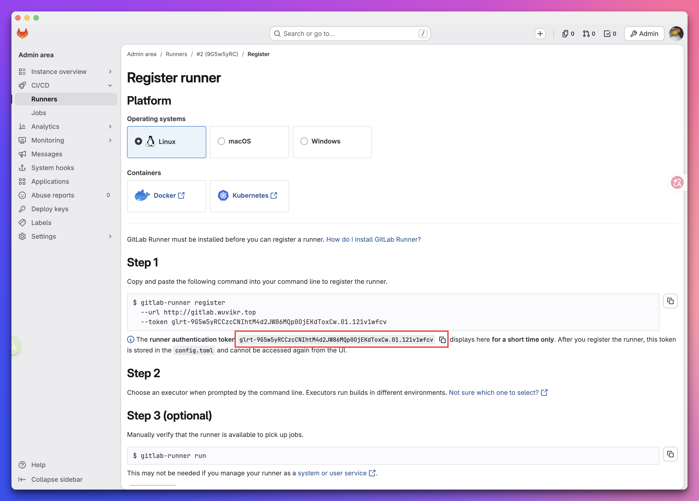

+++
date = '2026-10-22T10:02:12+08:00'
draft = false
title = 'GitLab CICD 入门和实践'
categories = ['DevOps']
tags = ['GitLab', 'CICD', 'Runner', '安装部署']
+++

# 1. 简介

## 1.1 GitLab CI/CD 是什么？

GitLab CI/CD 可以理解为：GitLab 内置的持续集成 / 持续交付引擎。代码提交、合并请求、打标签或定时触发后，GitLab 会根据项目里的 `.gitlab-ci.yml` 生成流水线，再交给 GitLab Runner 去执行构建、测试、扫描、打包、部署等任务。

它的整体架构可以分成三层：
| **层级** | **组件** | **作用** |
| :---: | :---: | :---: |
| 控制层 | GitLab Server | 解析 `.gitlab-ci.yml`，生成 Pipeline，分发 Job，展示结果 |
| 执行层 | GitLab Runner | 从 GitLab 拉取任务，执行脚本，回传日志和产物 |
| 环境层 | Executor | 决定 Job 跑在哪里，比如 Docker、Kubernetes、Shell、SSH 等 |

一个典型的 Gitlab CICD 执行链路如下所示：
```plaintext
开发者 push 代码或创建 MR，触发流水线
    ↓
GitLab 读取仓库里的 .gitlab-ci.yml，生成 Pipeline 流水线作业
    ↓
Runner 轮询到待执行的任务，领取 Job
    ↓
Job 的 Tag 会和 Executor 的 Tag 进行匹配，匹配成功后，Executor 去执行 Job
    ↓
执行完成后，日志、制品、状态回传到 GitLab，在页面上可以查看结果
```

## 1.2 如何定义流水线？

一个流水线本质上由两个核心概念构成：

- **Stage（阶段）**：可以理解为流水线上的各个关卡，常见的如 `build`、`test`、`deploy`。默认情况下，阶段按顺序依次执行——只有当前阶段的所有 Job 都成功跑完后，下一个阶段才会启动。
- **Job（作业）**：阶段内具体执行的任务单元，本质上就是一段脚本。同一个阶段下的多个 Job 之间是并行运行的。

来看一个最简单的示例：

```yaml
stages:          # 定义所有阶段
  - build
  - test

build-job:       # 第一个 Job
  stage: build
  tags:
    - build
  script:
    - echo "Building..."

test-job:
  stage: test
  tags:
    - test
  script:
    - echo "Testing..."
```

将文件编辑完成后 commit 并推送，就能在 GitLab 项目左侧的 `Pipelines`页面看到刚刚生成的流水线记录了。你可能已经发现了，这个生成的流水线作业状态为`Pengding`，这是因为我们还没有部署 Runner，没有工作人员，Job 当然只能挂在那，无人认领。


## 1.2 Runner 和 Excutor

在 1.1 部分，介绍了常见的 CICD 执行链路，从中不难看出，**GitLab 本身不干活，它只负责定义流水线和展示结果；真正接任务的是Runner**。Runner 是一个独立的开源项目，使用 Go 语言编写。

它是 GitLab 用来执行 CI/CD 任务的“工人”；是独立于 GitLab 的一套应用，通过一个令牌（token）和你的 GitLab 注册绑定，之后就不停地轮询，看有没有新任务派下来。只需要在仓库根目录放一个 `.gitlab-ci.yml`，GitLab 每次收到代码提交，就会照这份文件把流水线编排出来，然后派给 Runner 去执行。

Runner 本身可以装在三种地方：

| **部署位置** | **执行器** | **隔离性** | **适合场景** |
| :---: | :---: | :---: | :---: |
| 虚拟机 | shell | 弱，直接在本机跑 | 小项目、快速验证 |
| Docker | docker | 好，每个 Job 起一个容器 | 最常见的推荐方案 |
| Kubernetes | kubernetes | 好，每个 Job 起一个 Pod，弹性伸缩 | 规模化、云原生团队 |

这里有个容易混淆的概念，**很多人会直接把 runner 当成就是 Excutor，实际上，Runner 跑在哪儿，和用哪种执行器，是两回事**。比如我可以在虚拟机上装 Runner，但让它用 docker 执行器；也可以在 K8s 里用 Helm 装 Runner，让它用 shell 执行器。

两者的真正区别在于职责和分工：
- **Runner** 解决的是"**谁去领活**"。它是一个常驻进程（`gitlab-runner` 这个 Go 二进制），在 GitLab 中有注册身份（token、tags、locked/paused 状态，以及 project / group / instance 级作用域），并通过轮询 jobs API 拉取任务。GitLab 后台 Settings → CI/CD 里展示的 Runner 列表，记录的就是这些身份。
- **Executor** 解决的是"**活怎么干**"。它是 Runner 内部可插拔的执行后端（shell、docker、kubernetes、ssh 等），通过 `config.toml` 中每个 `[[runners]]` 段落的 `executor` 字段指定。

另外，**一个 Runner 进程可以挂载多个 `[[runners]]`，同时运行多种 executor**，两者并非一一对应：

```toml
concurrent = 10

[[runners]]
  name = "build"
  executor = "docker"
  [runners.docker]
    image = "golang:1.22"

[[runners]]
  name = "deploy"
  executor = "ssh"
  [runners.ssh]
    host = "10.0.0.5"
```
上述同一个 Runner 进程，既能领 Docker 的活，也能领 SSH 的活。之所以值得分开讲，主要有三个实用层面的原因：

1. **故障定位的边界不同。** "Runner 不领活"通常出在注册 token、网络或 paused 状态，属于 Runner 层面；"领了活但跑不起来"则大多出在 executor 及其环境（镜像拉取失败、kubeconfig 过期、daemon 挂掉等）。区分清楚两者的区别可以帮助我们更快的排查问题。

2. **扩缩容和成本的杠杆点在 executor。** `concurrent` 只控制进程级并发上限，实际资源消耗完全取决于 executor：shell 共享主机易互相污染，docker 每个 job 一个容器，kubernetes 每个 job 一个 Pod。选错 executor，把 `concurrent` 调再高也没用。

3. **混跑不同 executor 是真实需求。** 常见做法是 shell runner 处理缓存预热和制品上传，docker runner 跑常规构建保证环境干净，kubernetes runner 应对突发流量。

> [!TIP] 提示：
> 生产环境能上 docker 或 kubernetes 就尽量别用 shell，隔离性差、容易互相污染。


# 2. 在虚拟机上部署 Runner

[Runner 官方文档](https://docs.gitlab.com/runner/)

> [!TIP] 提示：
> 官方明确建议，GitLab Runner 的主、次版本应当与 GitLab 的主、次版本保持同步。如果版本存在差异，部分功能可能不可用或者工作异常。
>
> 例如，你的GitLab 安装的是最新的`19.4.1`版本，那么你的 Runner 最合适的版本范围是`19.4.x`。

## 2.1 安装 Runner 程序
**方式 A：用官方 apt 源装**
如果网络没问题的话，推荐这种方式，升级管理比较方便。
```bash
# 添加官方安装源
curl -L "https://packages.gitlab.com/install/repositories/runner/gitlab-runner/script.deb.sh" | bash

# 查看所有版本信息
apt-cache madison gitlab-runner

# 安装指定版本
apt install gitlab-runner=19.4.1-1
```

**方式 B：直接下载二进制**
[官方 release 页面](https://gitlab.com/gitlab-org/gitlab-runner/-/releases)

[清华大学镜像站](https://mirrors.tuna.tsinghua.edu.cn/gitlab-runner/)

在上面的 release 页面，选择合适版本和架构的安装包下载，有 `runner + helper-images` 两个安装包，都需要安装，注意两个安装包的版本要一致。

```bash
# 安装
dpkg -i gitlab-runner*.deb
```

验证一下：

```bash
gitlab-runner --version
```

## 2.2 注册 Runner
在 GitLab 上找到 **Admin area → CI/CD → Runners** 页面，点击 **Create instance runner**，填写 Tag 信息，还有一些可配置选项，点击 **Create runner**。

然后会跳转到下面的页面：


页面有详细的引导步骤和 **注册令牌（registration token）** 。你可以按照上面的 step 去做。复制命令在 runner 机器上执行，会出现交互式 shell，让你填入 GitLab 的服务器信息，Token，runner 的描述信息，执行器的类型等等。
```bash
root@worker01:~# gitlab-runner register  --url http://gitlab.wuvikr.top  --token glrt-9dA4UxSqTkuDqOytdL0qmW86MQp0OjEKdToxCw.01.120wcafxc
Runtime platform                                    arch=arm64 os=linux pid=2219762 revision=3c39fceb version=19.4.1
Running in system-mode.

Enter the GitLab instance URL (for example, https://gitlab.com/):
[http://gitlab.wuvikr.top]:
Verifying runner... is valid                        correlation_id=01M4WRYDB9XWZVXD14377T1XN8 runner=9dA4UxSqT runner_name=worker01.wuvikr.top
Enter a name for the runner. This is stored only in the local config.toml file:
[worker01.wuvikr.top]: shell runner on worker01
Enter an executor: shell, instance, docker, docker-autoscaler, docker+machine, ssh, custom, docker-windows, kubernetes, parallels, virtualbox:
shell
Runner registered successfully. Feel free to start it, but if it's running already the config should be automatically reloaded!

Configuration (with the authentication token) was saved in "/etc/gitlab-runner/config.toml"
```
等熟悉了以后，拿到令牌后直接回到服务器，使用非交互注册命令直接完成注册：
```bash
gitlab-runner register \
  --non-interactive \
  --url "http://gitlab.wuvikr.top" \
  --registration-token "你的令牌" \
  --executor "docker" \
  --docker-image alpine:latest \
  --docker-pull-policy "if-not-present" \
  --description "ubuntu-docker-runner" \
  --tag-list "build, test" \
  --run-untagged="true"
```
如果机器还没装 Docker，可以先把 `--executor` 改成 `shell`，先让它能跑起来。注册完的信息会存到 `/etc/gitlab-runner/config.toml`。在 GitLab 页面也可行查看到详细信息。

## 2.4 启动并验证

```bash
sudo gitlab-runner start
sudo gitlab-runner verify
```

然后随便修改一下代码并 push，去流水线页面看它是不是被这个 Runner 执行了，一般流水线完成还会有邮件通知发出。


# 3. 在 Kubernetes 里部署 Runner
在 K8s 集群中部署 Runner 时，官方推荐使用 **Helm chart** 进行部署。该方式会自动配置 Kubernetes 执行器，使每个 Job 在指定的 Namespace 中动态创建独立的 Pod 来运行。

## 3.1 安装 Runner

1. 添加 Helm 仓库：

```bash
helm repo add gitlab https://charts.gitlab.io

# 更新仓库
helm repo update gitlab

# 列出 gitlab-rnner 版本
helm search repo -l gitlab/gitlab-runner
```

2. 创建 `values.yaml`：重点需要配置的就四个：GitLab 地址、Runner 令牌、允许 runner 创建 Pod（RBAC），Runner 的镜像版本：
```yaml
gitlabUrl: http://gitlab.wuvikr.top
runnerToken: "在页面获得的 Runner 令牌"

rbac:
  create: true          # 允许 Runner 创建 Pod
  serviceAccount:       # 创建 SA
    create: true
    name: gitlab-runner

concurrent: 10    # 并发数

# ========== Runner 版本配置 ==========
image:
  registry: registry.gitlab.com
  repository: gitlab-org/gitlab-runner
  tag: alpine-v19.4.0
  pullPolicy: IfNotPresent

# ========== runners.config 配置（Excutor） ==========
runners:
  executor: kubernetes
  config: |
    [[runners]]
      [runners.kubernetes]
        namespace = "gitlab-runner"
        image = "alpine"
        helper_image = "registry.gitlab.com/gitlab-org/gitlab-runner/gitlab-runner-helper:v19.4.0"
```
> [!TIP] 提示：
> 由于我这里做实验部署的 GitLab 没有配置 https，因此上面的配置中走的 HTTP 协议，实际生产中必须走 HTTPS 保证服务安全。

3. **执行安装**
```bash
helm install --namespace gitlab-runner \
  gitlab-runner -f values.yaml gitlab/gitlab-runner
```
部署完成，可以在 k8s 集群的 gitlab-runner namespace 下看到运行的 runner pod，在 GitLab 页面上列表中可以查看详细信息。

## 3.2 更新升级
helm 部署的Runner，升级也十分简便，直接编辑现有的`values.yaml`，更换镜像版本，然后使用`helm upgrade`命令滚动更新，不需要删了重装。

遇到其他配置参数需要修改的场合也是一样的逻辑，直接更新`values.yaml`文件，然后升级即可。

下面是优化后的 Runner 的配置：
```yaml
gitlabUrl: http://gitlab.wuvikr.top
runnerToken: "Runner 令牌"

rbac:
  create: true          # 允许 Runner 创建 Pod
  serviceAccount:       # 创建 SA
    create: true
    name: gitlab-runner

concurrent: 10    # 并发数

# ========== Runner 版本配置 ==========
image:
  registry: registry.gitlab.com
  repository: gitlab-org/gitlab-runner
  tag: alpine-v19.4.0
  pullPolicy: IfNotPresent

# ========== runners.config 配置（Excutor） ==========
runners:
  executor: kubernetes
  config: |
    [[runners]]
      [runners.kubernetes]
        namespace = "gitlab-runner"
        image = "alpine"
        helper_image = "registry.gitlab.com/gitlab-org/gitlab-runner/gitlab-runner-helper:v19.4.0"

```
更新升级：
```bash
helm upgrade gitlab-runner -f values.yaml -n gitlab-runner gitlab/gitlab-runner
```

---


# 4. Runner 在页面上的配置

Runner 注册好之后，大部分日常操作都是在页面上做的。入口通常是：

- **项目级**：项目 → Settings → CI/CD → Runners
- **群组/实例级**：群组或管理员 → CI/CD → Runners

页面里每个 Runner 有几个常用的配置：

| **配置项** | **作用** | **建议** |
| :---: | :---: | :---: |
| **Tags** | 给 Runner 打标签，Job 用 `tags:` 指定 | 按用途打，如 `k8s`、`docker`、`gpu` |
| **Locked** | 是否只服务指定项目 | 专用 Runner 建议锁定 |
| **Run untagged jobs** | 是否接没有标签的 Job | 共享 Runner，建议关掉，避免乱接任务 |
| **Pause** | 暂停，停止接活 | 升级/维护前先暂停，很管用 |

# 5. 生产最佳实践与建议

- **并发与容量**：按 CI 的量和 Job 时长设置 `concurrent`，K8s 场景结合集群资源配额（requests/limits）一起调。并发配太小 Job 会排队，配太大机器会被打满。
- **容器优先**：生产环境能用 docker / kubernetes 执行器就别用 shell。shell 直接在本机跑，依赖、环境互相污染，还容易把脏东西留在机器上。
- **用 Tags 做准入控制**：给 Runner 打标签，让 Job 通过 `tags:` 精确落到指定 Runner（比如 `k8s`、`gpu`），避免任务跑到不匹配的环境里莫名失败。
- **权限最小化**：CI/CD Variables 里的敏感值一律 Masked + Protected；Harbor 账号用专用 CI 账号，别用管理员；K8s Runner 的 ServiceAccount 只给最小权限。
- **缓存与制品治理**：配分布式缓存（S3 / MinIO），别把缓存堆在 Runner 本机，否则多 Runner 集群缓存会失效；制品（artifacts）设置过期时间，`expire_in` 建议设置为 1 小时过期，避免磁盘被撑爆。
- **版本同步**：升级 GitLab 时同步升级 Runner，版本不匹配容易出现奇怪的兼容问题。


---

# 6. 参考文档

- [Get started with GitLab CI/CD](https://docs.gitlab.com/ci/)
- [CI/CD YAML syntax reference](https://docs.gitlab.com/ci/yaml/)
- [Install GitLab Runner on GNU/Linux](https://docs.gitlab.com/runner/install/linux/)
- [Registering runners](https://docs.gitlab.com/runner/register/)
- [GitLab Runner Helm chart](https://docs.gitlab.com/runner/install/kubernetes/)
- [Kubernetes executor](https://docs.gitlab.com/runner/executors/kubernetes/)
- [GitLab CI/CD runners](https://docs.gitlab.com/ci/runners/)

